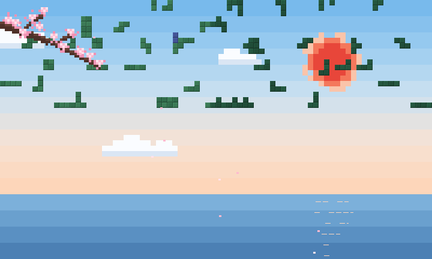

<!-- The AUTO:badges block and the ⛩️ Now row are refreshed from live GitHub data by
     assets/make_panels.py (run on a schedule by .github/workflows/profile.yml). -->

<!-- AUTO:badges -->

<!-- /AUTO:badges -->

  

<picture>
  <source media="(prefers-color-scheme: dark)" srcset="assets/fuji-dark.gif" />
  <source media="(prefers-color-scheme: light)" srcset="assets/fuji-light.gif" />
  
</picture>

## About me

Software developer focused on **cybersecurity** and **AI-driven systems**. I research machine learning for web privacy, build hands-on security labs and tools, and I'm studying for **CompTIA Security+** and **Cisco CCNA**.

## Tech

## Featured projects

- 📚 [**Libr-AI-ry**](https://github.com/HayzeuMagic/Libr-AI-ry) — AI-powered library management system (Django, React, MySQL) with a librarian chatbot and borrowing analytics
- 🔴 [**claude-red-labs**](https://github.com/HayzeuMagic/claude-red-labs) — offline AI-assisted pentesting labs built on Claude-Red and Ollama
- 🔬 [**First-Party-Tracking-Cookie-Detection**](https://github.com/HayzeuMagic/First-Party-Tracking-Cookie-Detection) — ML study detecting first-party tracking cookies
- 🦈 [**wireshark-labs**](https://github.com/HayzeuMagic/wireshark-labs) — Wireshark malware-traffic exercises
- 🕵️ [**tookie-osint**](https://github.com/HayzeuMagic/tookie-osint) — OSINT tool that finds social-media accounts
- 📦 [**py-to-exe**](https://github.com/HayzeuMagic/py-to-exe) — Windows app that packages Python projects into executables

➡️ [All repositories](https://github.com/HayzeuMagic?tab=repositories)

## Milestones

| | When | Milestone |
|:-:|---|---|
| 🔬 | **August 2026** | Published ML research on first-party tracking-cookie detection |
| 🔴 | **October 2026** | Released claude-red-labs and interactive Wireshark labs |
| 📚 | **November 2026** | Overhauled Libr-AI-ry: fixed its database setup and core bugs and got the full stack running end to end |
| ⛩️ | **Now** | 358 contributions in the last year, 35-day streak and counting |
| 🗻 | **Next** | CompTIA Security+ and Cisco CCNA certifications |
