<!-- ======================= RED SUN HEADER ======================= -->
<!-- Sections between AUTO markers are rewritten from live GitHub data by assets/make_panels.py
     (run on a schedule by .github/workflows/profile.yml). Edit the script, not these lines. -->

<!-- AUTO:badges -->

<!-- /AUTO:badges -->

<!-- ======================= RED FUJI ======================= -->

<picture>
  <source media="(prefers-color-scheme: dark)" srcset="assets/fuji-dark.gif" />
  <source media="(prefers-color-scheme: light)" srcset="assets/fuji-light.gif" />
  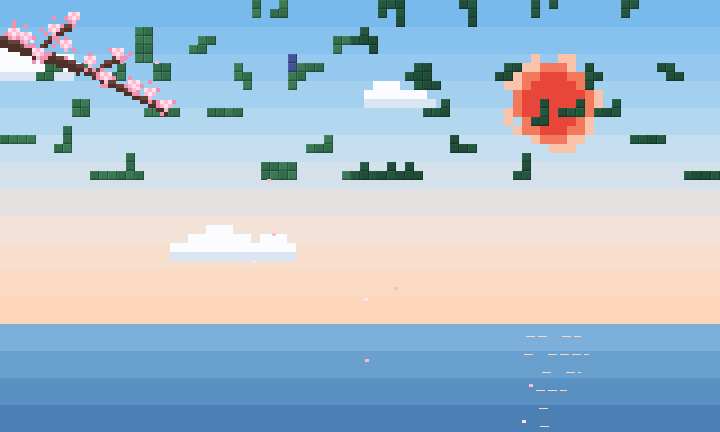
</picture>

Every block of code finds its place — each piece a project, the structure a mountain. ⛩️

  
<!-- AUTO:about -->
  
<!-- /AUTO:about -->

  

 

 

<!-- AUTO:repos -->
  

<table>
<tr>
<td></td>
<td></td>
<td><a href="https://github.com/HayzeuMagic/wireshark-labs"></a></td>
</tr>
<tr>
<td></td>
<td></td>
<td><a href="https://github.com/HayzeuMagic/DNS-CONFIG"></a></td>
</tr>
<tr>
<td></td>
<td><a href="https://github.com/HayzeuMagic/SECplus701"></a></td>
<td><a href="https://github.com/HayzeuMagic/tookie-osint"></a></td>
</tr>
<tr>
<td></td>
<td><a href="https://github.com/HayzeuMagic/ccna2"></a></td>
<td><a href="https://github.com/HayzeuMagic/Trivia-Duel"></a></td>
</tr>
<tr>
<td></td>
<td></td>
<td></td>
</tr>
<tr>
<td><a href="https://github.com/HayzeuMagic/Libr-AI-ry"></a></td>
</tr>
</table>
<!-- /AUTO:repos -->

  

<!-- AUTO:stats -->
<!-- /AUTO:stats -->

<picture>
  <source media="(prefers-color-scheme: dark)" srcset="https://raw.githubusercontent.com/HayzeuMagic/HayzeuMagic/output/red-snake-dark.svg" />
  <source media="(prefers-color-scheme: light)" srcset="https://raw.githubusercontent.com/HayzeuMagic/HayzeuMagic/output/red-snake.svg" />
  
</picture>

  

| | When | Milestone |
|:-:|---|---|
| 🔬 | **August 2026** | Published ML research on [first-party tracking-cookie detection](https://github.com/HayzeuMagic/First-Party-Tracking-Cookie-Detection) |
| 🦈 | **October 2026** | Launched interactive [Wireshark labs](https://github.com/HayzeuMagic/wireshark-labs) and opened the first issue on [docker-guide](https://github.com/HayzeuMagic/docker-guide/issues/1) |
| 🔴 | **October 2026** | Released [claude-red-labs](https://github.com/HayzeuMagic/claude-red-labs): fully offline AI-assisted pentesting labs with Claude-Red and Ollama |
| ⛩️ | **Now** | 154 contributions in the last year, 3-day streak and counting |
| 🗻 | **Next** | CompTIA Security+ and Cisco CCNA certifications |

  
  

